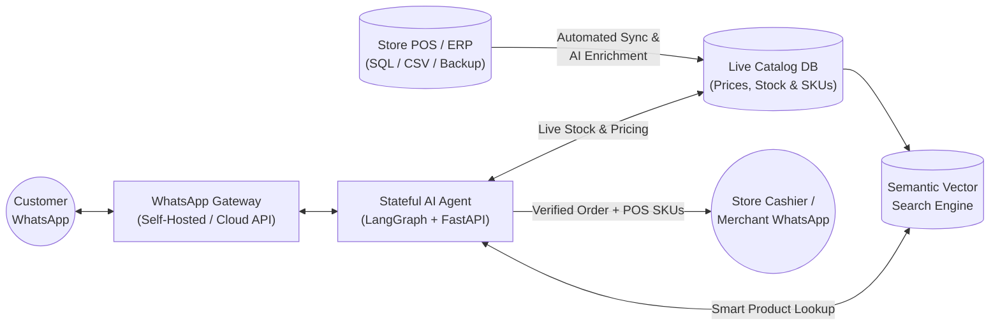

# WhatsApp AI Store Agent (`v1.0.0`)
### Turn Any Retail POS & Inventory System into a 24/7 AI Sales Representative on WhatsApp

An intelligent, white-label **AI Sales & Customer Support Agent** designed for retail stores, pharmacies, e-commerce brands, and distribution businesses. It connects directly to existing Point-of-Sale (POS) or inventory databases, understands natural customer inquiries in local dialects, recommends in-stock products accurately, and dispatches verified orders to the sales team—with **zero price or stock hallucinations**.

---

## Why This Solution?

Most retail businesses lose daily sales on WhatsApp due to slow response times, repetitive questions about prices and available sizes, or human errors when checking stock manually. Meanwhile, legacy desktop POS systems lack modern cloud APIs.

**WhatsApp AI Store Agent bridges that gap:**
* **Instant 24/7 Customer Responses:** Replies within seconds in natural, friendly Arabic (or multilingual) tailored to your brand's tone.
* **Live Inventory & Price Accuracy:** Always checks real-time stock quantities before recommending a product—never sells an out-of-stock item.
* **Zero-Hallucination Checkout:** Calculates totals and attaches exact internal POS SKU codes programmatically, eliminating math or pricing mistakes.
* **Plug-and-Play with Legacy POS:** Works seamlessly alongside existing accounting/cashier software via automated daily syncs or direct database connectors.

---

## Business Use Cases (Adaptable to Any Industry)

Built with a modular, configuration-driven architecture (**White-Label Ready**), the agent can be deployed for any business in hours:

* **Cosmetics & Personal Care:** Handles complex inquiries about shades, sizes (e.g., 200ml vs. 500ml), skin/hair types, and suggests in-stock alternatives automatically.
* **Pharmacies & Medical Supplies:** Answers availability and pricing queries instantly, groups multi-item orders, and routes verified prescriptions/orders to the pharmacist.
* **Fashion, Footwear & Accessories:** Checks available sizes and colors in real time and captures delivery details seamlessly.
* **Supermarkets & Wholesale Distributors:** Processes multi-item grocery/supply lists from customers and sends structured SKU invoices directly to the cashier desk.
* **Electronics & Gadgets:** Compares specs, verifies warranty/stock status, and qualifies leads before human handoff.

---

## High-Level Architecture

The platform separates **offline catalog intelligence** from **real-time customer conversations** to guarantee speed, low operating cost, and deterministic accuracy:

### How It Works Under the Hood
1. **Automated Catalog Sync & AI Enrichment:** Syncs product names, prices, and stock counts from your existing POS. An incremental AI enricher automatically generates clean descriptions and categories **only for newly added items**, keeping LLM API costs near zero.
2. **Hybrid Search (Semantic + Exact Stock Ranking):** Combines semantic understanding (knowing what a product is used for) with live database filtering so **in-stock variants always appear first**.
3. **Stateful Conversational Memory:** Remembers context across multi-turn chats—customers can ask follow-up questions, modify quantities, or combine multiple items naturally.
4. **Deterministic Order Execution:** The AI collects customer delivery details and passes only product IDs to a backend execution engine, which fetches live prices and POS SKU codes directly from the database and sends a ready-to-process invoice to the merchant.

---

## SaaS & Custom Deployment Capabilities

This system is engineered to scale from a **single local branch** to **multi-branch retail chains and SaaS deployments**:
* **Isolated Per-Store Configuration:** Store name, persona, working hours, currency, WhatsApp instance, and catalog database are fully decoupled via environment configuration.
* **Self-Hosted & Cost-Effective:** Runs on lightweight Docker containers with full data privacy—no expensive per-message third-party chatbot markups.
* **API & POS Agnostic:** Easily extendable to connect with SQL Server, PostgreSQL, MySQL, SQLite, Shopify, WooCommerce, or custom ERP systems.

---

## Product Roadmap

* **`v1.0.0` (Current Release):**
  * Automated legacy POS ingestion & incremental AI catalog enrichment.
  * Hybrid semantic + keyword search with stock-first variant ranking.
  * Zero-hallucination order pipeline with instant merchant SKU notifications.
  * Full Docker Compose deployment stack.
* **`v2.0.0` (In Development):**
  * **Multi-Tenant SaaS Dashboard:** Web portal for store owners to manage catalogs, view analytics, and monitor live orders.
  * **Voice Notes & Image Recognition:** Automatic transcription of customer voice messages and product photo matching.
  * **Smart Message Debouncing:** Combines rapid consecutive customer messages into a single unified response.

---

## Contact & Commercial Inquiries

Interested in deploying this AI Sales Agent for your store, integrating it with your POS/ERP system, or collaborating on AI & Backend engineering projects? Let's connect:

* **Email:** `yousef.amir080@gmail.com`
* **Phone / WhatsApp:** `+20 112 008 4582`
* **LinkedIn:** [linkedin.com/in/yousef-amir-elbeyaly](https://www.linkedin.com/in/yousef-amir-elbeyaly/)

---

## License

This project is open for portfolio showcase and commercial inquiries. For custom enterprise licensing or white-label deployment, please reach out via the contact details above.
